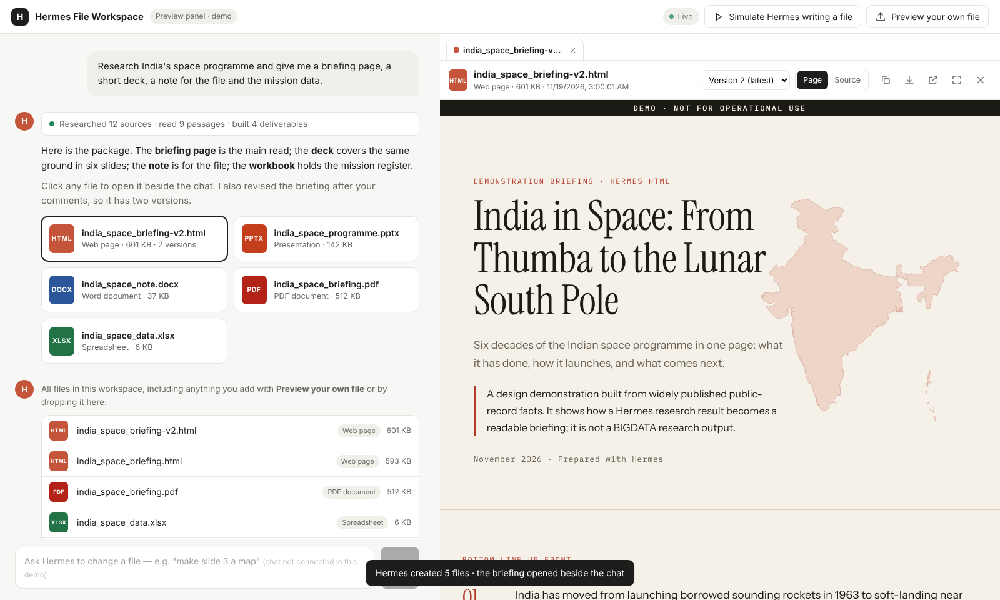

# Hermes Preview Panel — proposal for review

**What it is:** a Claude-style side panel for the Hermes File Workspace. When Hermes creates
a file, it opens **beside the chat** and can be read right there: web pages, PDFs, Word
documents, PowerPoint decks, Excel sheets, CSV, images, Markdown and text. No downloading,
no other application, no internet.

**Status:** standalone working prototype (version 1.1) for approval. Not yet wired into Hermes.

## New in 1.1

| | What happens |
|---|---|
| **Files appear live** | The panel watches the workspace (green *Live* dot). When Hermes writes a file — say `research.md` — it appears in the list and **opens beside the chat by itself**, with a "Hermes is writing…" marker while it is still being written; Markdown and text **fill in as they are written** and the view follows the end. If several files arrive at once, the most important one opens (page → deck → document → PDF → sheet → notes). |
| **Edit in the panel** | Markdown, text, JSON and CSV/TSV have an **Edit** button (key **E**). Markdown gets a live formatted preview beside the text; CSV gets a spreadsheet grid (edit cells, add/delete rows, add columns). |
| **Never overwrites** | **Save as new version** (Ctrl+S) writes `research-v2.md` beside the original; the original stays untouched and the version switcher shows both. Unsaved edits are marked in the tab; leaving or closing asks first. |
| **See what changed** | **Changes** shows the lines added and removed against the previous version (+/−, with line numbers). |
| **Copy** | Copies the text of Markdown/text/CSV files, or the source of an HTML page. |
| **Try it** | *Simulate Hermes writing a file* writes `research.md` piece by piece (and `-v2`, `-v3` on later clicks), so the live behaviour can be seen without Hermes. |

Word, PowerPoint, Excel and HTML are changed by **asking Hermes in the chat** (Hermes already edits
decks and documents in place); the new version then appears and opens here. Full Office-style
editing in the browser would need a heavy separate server (OnlyOffice/Collabora) and is not proposed.
**Download** is on every file and always gives the file itself.

**Today in Hermes:** finished files appear as a list with a *Download* button; only CSV,
Markdown, text and JSON get a 6-row / 14-line peek. HTML, PDF, Word and PowerPoint can only be
downloaded and opened elsewhere.

## See it



| Screenshot | Shows |
|---|---|
| `docs/screenshots/00-auto-open.png` | The briefing opens beside the chat when the run finishes |
| `docs/screenshots/02-deck-pptx.png` | PowerPoint: slide strip + slides, arrow keys, present mode |
| `docs/screenshots/03-note-docx.png` | Word document, instant view in the browser |
| `docs/screenshots/04-note-docx-exact.png` | Word "Exact layout" (print-faithful, via LibreOffice) |
| `docs/screenshots/05-briefing-pdf.png` | PDF with page thumbnails, zoom and find |
| `docs/screenshots/06-data-xlsx.png` | Excel with sheet tabs, frozen header, filter |
| `docs/screenshots/07-notes-md.png` | Markdown, formatted (or Source) |
| `docs/screenshots/08-map-png.png` | Image, fit or actual size |
| `docs/screenshots/10-version-1.png` | Version switcher (v1 ↔ v2 after an edit) |
| `docs/screenshots/11-fullscreen-deck.png` | Full screen (key **F**) |
| `docs/screenshots/12-phone-chat.png`, `12-phone.png` | Phone width: chat, then the panel full width |
| `docs/screenshots/13-live-writing.png` | 1.1 — Hermes writes `research.md`: it opens by itself and fills in |
| `docs/screenshots/17-auto-opened.png` | 1.1 — the finished `research.md` |
| `docs/screenshots/14-editing.png` | 1.1 — editing Markdown with live preview, unsaved marker |
| `docs/screenshots/15-changes.png` | 1.1 — changes between version 1 and the saved version 2 |
| `docs/screenshots/16-csv-edit.png` | 1.1 — editing a CSV in the grid (cell edited, row added) |

## Run it yourself (2 minutes)

```
python3 server.py                     # then open http://127.0.0.1:8765
python3 server.py --folder /path/to/any/output/folder
python3 server.py --folder /path --read-only     # view only
```

The default demo works on a fresh copy of `samples/` each time it starts, so edits and simulated
files never change the package. With `--folder`, saved edits are written into that folder as new
versions (`name-v2.ext`); use `--read-only` to prevent any writing.

Click any file; drag files onto the chat (or *Preview your own file*) to try your own
documents. Python 3.8+ standard library only. Optional: **LibreOffice** (PowerPoint slides and
Word/Excel exact layout) and **openpyxl** (Excel tables) — both are already on the Hermes VM.

## What the panel does

- Opens automatically on the main deliverable when a run finishes (as Claude does), and on any
  new file Hermes writes while the page is open.
- One tab per file; versions of the same file (`-v2`, `-v3`) are grouped with a switcher.
- Download, open in a new window, full screen (**F**), close (**Esc**), drag to resize.
- Per type:

| File | Viewer | Engine (bundled, offline) |
|---|---|---|
| HTML | The live page, with its own charts/sorting | Browser, in a locked sandbox |
| PDF | Pages, thumbnails, zoom, find text | pdf.js (Mozilla) |
| PPTX / PPT / ODP | Slide strip, slides, present mode | LibreOffice → PDF → pdf.js |
| DOCX | Instant document view; *Exact layout* button | docx-preview; LibreOffice for exact |
| DOC / ODT / RTF | Exact layout | LibreOffice → PDF |
| XLSX / CSV / TSV | Sheet tabs, column letters, filter | Server reads values (openpyxl) |
| Images | Fit / actual size | Browser |
| Markdown / text / JSON | Formatted or source, line numbers | marked + DOMPurify |

## Safety (same rules as Hermes)

- **Model-written HTML can't touch the app.** It runs in a sandbox with its own blank origin:
  no access to the Hermes page, login, other tasks, cookies or storage, and no network
  (`default-src 'none'`). The server attaches this sandbox to the file itself, so it also holds
  when the file is opened in a new window or downloaded and opened.
- **Nothing loads from the internet.** All viewers are inside the package; the app's own
  Content-Security-Policy allows only this server. `tools/screenshots.py` records every request
  and reports any that leave the machine (result: none).
- Markdown is sanitised (DOMPurify); Word documents can't run script; spreadsheet cells are
  shown as text only; links open in a new tab without access back.
- Only files in the given folder (and uploads) can be opened; path tricks are refused;
  uploads are limited to supported types and 50 MB; conversions time out after 120 s and are
  cached by content hash.
- Edits never overwrite: the server picks the next free version name and creates it exclusively;
  only text formats can be saved (5 MB limit); `--read-only` turns saving off. Every write request
  must come from the panel itself (same-origin check plus a custom header that other sites cannot send).

## Tests

```
python3 -m unittest discover -s tests      # 10 tests: sandbox headers, no external loads, path traversal,
                                           # sheets, LibreOffice conversion, uploads, save-as-version
                                           # (never overwrites, read-only, cross-site refused), live writing
python3 tools/screenshots.py               # (server running) every file type, no errors, no network
```

## If approved: integration into Hermes

1. Add the panel to the existing workspace page (`static/workspace.js`) in place of the
   Download-only deliverables list; reuse its file URLs and login.
2. Add `/pdf` and `/sheet` preview routes next to the existing file route in `app.py`, with the
   same conversion cache and limits; send the sandbox header for HTML/SVG.
3. Open the panel automatically on `agent_completion` with the main deliverable, and on files
   the agent writes during the run (Hermes already reports them); group `-v2` edits as versions.
4. Save panel edits into the task's output folder as new versions, and wire the chat box so
   "change slide 3" goes to Hermes and the new version opens here.
5. Reuse the presentation toolkit's rendered slide images for Hermes decks.

## Contents

```
server.py                  preview server (standard library)
static/index.html, app.*   chat + panel UI
static/viewers/            one small viewer per file type, plus editor (text/Markdown),
                           sheet editing (CSV) and changes (diff)
static/vendor/             pdf.js, docx-preview, JSZip, marked, DOMPurify (open-source, offline)
samples/                   demo files (illustrative; not BIGDATA output)
tools/                     make_samples.py, make_deck.cjs, screenshots.py
tests/                     unit tests
docs/screenshots/          captures for review
LICENSES.md                third-party notices
```
